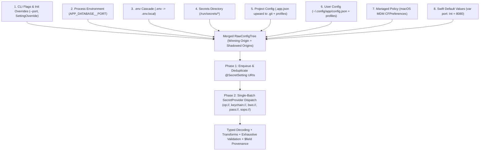

# ``Rigging``

Strongly typed, multi-source configuration, batched leak-proof secrets, and per-field provenance for Swift 6.

## Overview

`Rigging` brings the declarative developer ergonomics of Python's `pydantic-settings` to Swift 6—purpose-built for command-line tools, background daemons, server services, and macOS/iOS applications. Annotate a struct with ``Settings(envPrefix:envNestedDelimiter:envNestedMaxSplit:caseSensitive:envIgnoreEmpty:envNullStrings:dotEnvFiles:projectConfigFiles:xdgAppName:profile:secretsDirectory:secretsNestedSubdir:trimSecretTrailingNewline:envListStrategy:managedPreferencesDomain:extraKeys:)`` (or ``Rigged(envPrefix:envNestedDelimiter:envNestedMaxSplit:caseSensitive:envIgnoreEmpty:envNullStrings:dotEnvFiles:projectConfigFiles:xdgAppName:profile:secretsDirectory:secretsNestedSubdir:trimSecretTrailingNewline:envListStrategy:managedPreferencesDomain:extraKeys:)`` in SwiftUI targets), and Rigging synthesizes multi-layer source loading, two-phase batched secret resolution, `$field` provenance inspection, and JSON Schema / `.env` documentation generation at compile time.

`Rigging` automatically re-exports `RiggingCore`, so a single `import Rigging` provides every macro, configuration source, validator, secret container, and provenance type needed to define and load configuration models.

### Architecture & 8-Layer Cascade



### Quick Example

```swift
import Foundation
import Rigging

@Settings(
    envPrefix: "ASC_",
    dotEnvFiles: [".env", ".env.local"],
    projectConfigFiles: [".asc.json"],
    xdgAppName: "asc",
    extraKeys: .forbid
)
public struct ASCSettings: Sendable, Equatable {
    /// 10-character App Store Connect Key ID.
    @Setting(
        aliases: [.configPath(["auth", "keyId"])],
        validate: .regex(#"^[A-Z0-9]{10}$"#)
    )
    public var keyId: String

    /// App Store Connect Issuer UUID.
    @Setting(aliases: [.configPath(["auth", "issuerId"])])
    public var issuerId: UUID

    /// PKCS#8 `.p8` private key (`op://`, `keychain://`, or `@~/.asc/AuthKey.p8`).
    @SecretSetting(
        aliases: [.configPath(["auth", "privateKey"])],
        transforms: [
            .expandFileReference(requirePermissions: 0o600),
            .decodeBase64IfPrefixed,
            .normalizePEM,
        ]
    )
    public var privateKey: Secret<String>

    /// Request timeout duration.
    @Setting
    public var timeout: Duration = .seconds(30)
}
```

### Ecosystem Modules

Keep binary size and dependency graphs minimal by importing only the adapter targets your executable needs:

- **`Rigging`** *(this module)*: Re-exports `RiggingCore` and provides `@Settings`, `@Rigged`, `@Setting`, `@SecretSetting`, `@NestedSettings`, and ``SettingTransform``.
- **`RiggingOnePassword`**: Batched `op inject` CLI and 1Password Connect REST secret provider (`op://`).
- **`RiggingKeychain`**: In-process Apple `Security.framework` Keychain provider (`keychain://`).
- **`RiggingBitwarden`**: Bitwarden Secrets Manager (`bws://`) and Vault CLI (`bw://`) provider.
- **`RiggingUnixPass`**: GPG-backed Unix `pass` (`pass://`) and Mozilla SOPS (`sops://`) providers.
- **`RiggingTOML`** & **`RiggingYAML`**: Zero-dependency TOML 1.0 and Yams-backed YAML file sources.
- **`RiggingArgumentParser`**: `@OptionGroup` CLI override binding and turnkey `ConfigSubcommand` (`show`, `doctor`, `schema`, `init`).
- **`RiggingSwiftConfiguration`**: Bidirectional adapters for Apple's `swift-configuration` (`ConfigReader` / `ConfigProvider`).
- **`RiggingTesting`**: Hermetic `InMemoryFileSystem`, `MockSubprocessRunner`, and mock secret providers.

## Topics

### Essentials

- <doc:GettingStarted>
- <doc:SecretsAndSecurity>
- <doc:ProvenanceAndDebugging>
- <doc:MigratingFromPydanticSettings>

### Model Macros

- ``Settings(envPrefix:envNestedDelimiter:envNestedMaxSplit:caseSensitive:envIgnoreEmpty:envNullStrings:dotEnvFiles:projectConfigFiles:xdgAppName:profile:secretsDirectory:secretsNestedSubdir:trimSecretTrailingNewline:envListStrategy:managedPreferencesDomain:extraKeys:)``
- ``Settings(envPrefix:envNestedDelimiter:envNestedMaxSplit:caseSensitive:envIgnoreEmpty:envNullStrings:extraKeys:dotEnvFiles:projectConfigFiles:xdgAppName:profile:secretsDirectory:secretsNestedSubdir:trimSecretTrailingNewline:envListStrategy:managedPreferencesDomain:)``
- ``Rigged(envPrefix:envNestedDelimiter:envNestedMaxSplit:caseSensitive:envIgnoreEmpty:envNullStrings:dotEnvFiles:projectConfigFiles:xdgAppName:profile:secretsDirectory:secretsNestedSubdir:trimSecretTrailingNewline:envListStrategy:managedPreferencesDomain:extraKeys:)``
- ``Rigged(envPrefix:envNestedDelimiter:envNestedMaxSplit:caseSensitive:envIgnoreEmpty:envNullStrings:extraKeys:dotEnvFiles:projectConfigFiles:xdgAppName:profile:secretsDirectory:secretsNestedSubdir:trimSecretTrailingNewline:envListStrategy:managedPreferencesDomain:)``

### Field & Nested Group Macros

- ``Setting(aliases:envListStrategy:resolveSecrets:help:deprecated:examples:)``
- ``Setting(aliases:envListStrategy:resolveSecrets:deprecated:help:examples:)``
- ``Setting(aliases:validate:envListStrategy:resolveSecrets:help:deprecated:examples:)-(_,SettingValidator<String>,_,_,_,_,_)``
- ``Setting(aliases:validate:envListStrategy:resolveSecrets:help:deprecated:examples:)-(_,SettingValidator<T>,_,_,_,_,_)``
- ``Setting(aliases:validate:envListStrategy:resolveSecrets:help:deprecated:examples:)-(_,[SettingValidator<String>],_,_,_,_,_)``
- ``Setting(aliases:validate:envListStrategy:resolveSecrets:help:deprecated:examples:)-(_,[SettingValidator<T>],_,_,_,_,_)``
- ``Setting(aliases:transforms:envListStrategy:resolveSecrets:help:deprecated:examples:)-(_,[SettingTransform<String>],_,_,_,_,_)``
- ``Setting(aliases:transforms:envListStrategy:resolveSecrets:help:deprecated:examples:)-(_,[SettingTransform<T>],_,_,_,_,_)``
- ``Setting(aliases:transforms:envListStrategy:resolveSecrets:help:deprecated:examples:)-(_,SettingTransform<String>,_,_,_,_,_)``
- ``Setting(aliases:transforms:envListStrategy:resolveSecrets:help:deprecated:examples:)-(_,SettingTransform<T>,_,_,_,_,_)``
- ``Setting(aliases:validate:transforms:envListStrategy:resolveSecrets:help:deprecated:examples:)-(_,SettingValidator<String>,_,_,_,_,_,_)``
- ``Setting(aliases:validate:transforms:envListStrategy:resolveSecrets:help:deprecated:examples:)-(_,SettingValidator<T>,_,_,_,_,_,_)``
- ``Setting(aliases:validate:transforms:envListStrategy:resolveSecrets:help:deprecated:examples:)-(_,[SettingValidator<String>],_,_,_,_,_,_)``
- ``Setting(aliases:validate:transforms:envListStrategy:resolveSecrets:help:deprecated:examples:)-(_,[SettingValidator<T>],_,_,_,_,_,_)``
- ``Setting(aliases:transforms:validate:envListStrategy:resolveSecrets:help:deprecated:examples:)-(_,_,SettingValidator<String>,_,_,_,_,_)``
- ``Setting(aliases:transforms:validate:envListStrategy:resolveSecrets:help:deprecated:examples:)-(_,_,SettingValidator<T>,_,_,_,_,_)``
- ``Setting(aliases:transforms:validate:envListStrategy:resolveSecrets:help:deprecated:examples:)-(_,_,[SettingValidator<String>],_,_,_,_,_)``
- ``Setting(aliases:transforms:validate:envListStrategy:resolveSecrets:help:deprecated:examples:)-(_,_,[SettingValidator<T>],_,_,_,_,_)``
- ``SecretSetting(aliases:transforms:allowLiteralInProjectConfig:help:deprecated:examples:)``
- ``SecretSetting(aliases:transforms:validate:allowLiteralInProjectConfig:help:deprecated:examples:)-(_,_,SettingValidator<String>,_,_,_,_)``
- ``SecretSetting(aliases:transforms:validate:allowLiteralInProjectConfig:help:deprecated:examples:)-(_,_,SettingValidator<T>,_,_,_,_)``
- ``SecretSetting(aliases:transforms:validate:allowLiteralInProjectConfig:help:deprecated:examples:)-(_,_,[SettingValidator<String>],_,_,_,_)``
- ``SecretSetting(aliases:transforms:validate:allowLiteralInProjectConfig:help:deprecated:examples:)-(_,_,[SettingValidator<T>],_,_,_,_)``
- ``SecretSetting(aliases:validate:transforms:allowLiteralInProjectConfig:help:deprecated:examples:)-(_,SettingValidator<String>,_,_,_,_,_)``
- ``SecretSetting(aliases:validate:transforms:allowLiteralInProjectConfig:help:deprecated:examples:)-(_,SettingValidator<T>,_,_,_,_,_)``
- ``SecretSetting(aliases:validate:transforms:allowLiteralInProjectConfig:help:deprecated:examples:)-(_,[SettingValidator<String>],_,_,_,_,_)``
- ``SecretSetting(aliases:validate:transforms:allowLiteralInProjectConfig:help:deprecated:examples:)-(_,[SettingValidator<T>],_,_,_,_,_)``
- ``NestedSettings()``

### Value Transforms

- ``SettingTransform``
